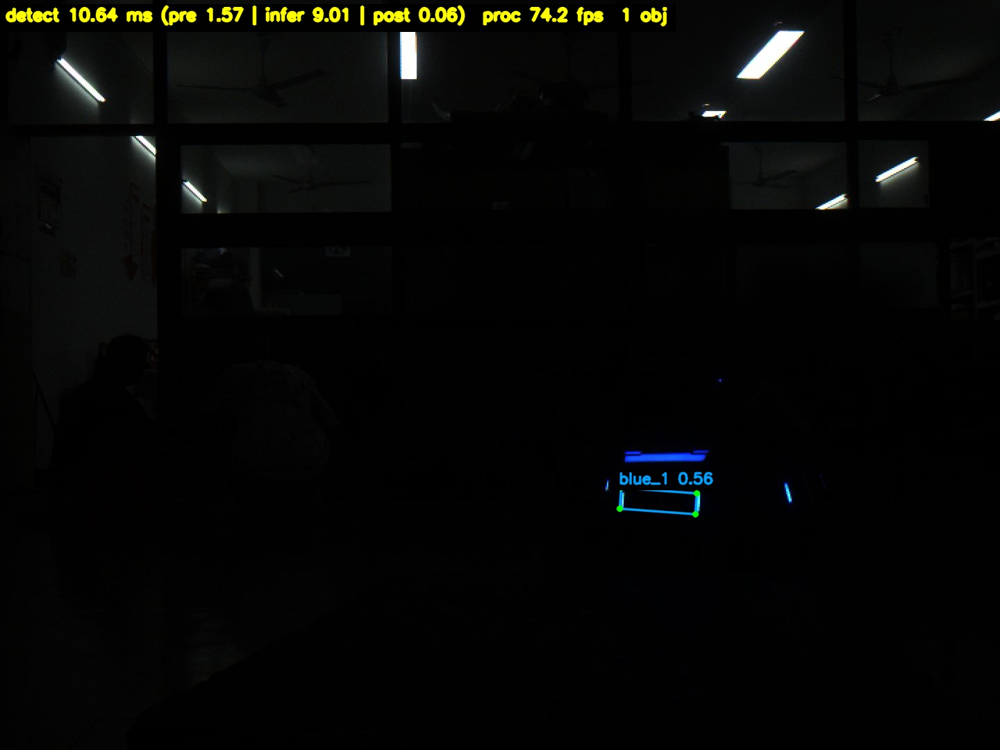
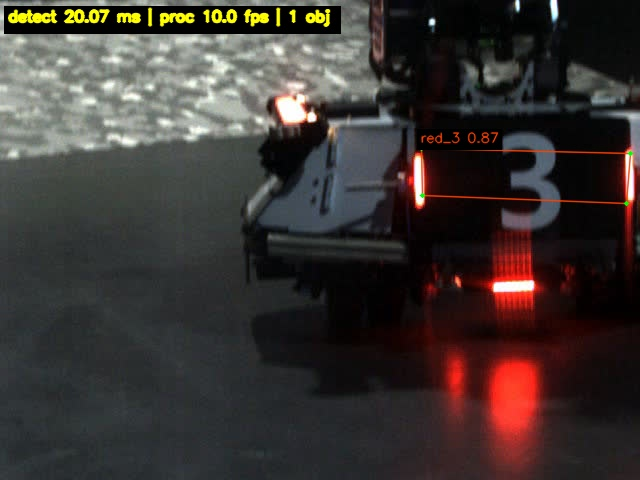

# hk_pose_openvino

ROS1（Noetic）nodelet 插件：用 **OpenVINO C++ Runtime** 跑
`runs/yolo11-pose/1027/epoch100_rm_23.onnx`（100 轮、23 通道、480×640），
也支持 `0526.onnx`（Infantry-v5：22 通道、640×640、4 关键点 + 4 颜色 + 9 类）。
订阅 `/hk_camera_cs/image_raw`，发布一张画好 **四个角点连成的框**、类别分数和
**本帧检测时间** 的图像。

launch 里直接创建 nodelet manager 并 `load` 本插件，没有额外的独立节点或 Python 包装。

> 小电脑 `dev_ws` 是 catkin_tools 工作区：
> `cd ~/dev_ws && catkin build hk_pose_openvino && source devel/setup.bash`。

---

## 1. 目录结构

```text
ros1_ws/
├─ build.sh                     # 容器内一键 catkin_make
├─ setup.bash                   # source /opt/ros/noetic + devel
└─ src/hk_pose_openvino/
   ├─ CMakeLists.txt
   ├─ package.xml
   ├─ nodelet_plugins.xml       # nodelet 插件描述
   ├─ include/hk_pose_openvino/
   │  ├─ openvino_detector.h    # ABI-neutral 接口（pimpl，不含 OpenVINO 头）
   │  └─ pose_nodelet.h
   ├─ src/
   │  ├─ openvino_detector.cpp  # OpenVINO 前后处理/解码/NMS（按 OpenVINO ABI 单独编译）
   │  └─ pose_nodelet.cpp       # ROS 订阅/发布/画框（ABI=1）
   ├─ launch/
   │  ├─ pose_openvino.launch        # 1027（23 通道）manager + 插件
   │  ├─ pose_openvino_0526.launch   # 0526（22 通道 V5 装甲板）
   │  └─ pose_openvino_test.launch   # 额外起一个本地图片发布器，无相机也能测
   ├─ models/epoch100_rm_23.onnx # 从 runs/yolo11-pose/1027/ 复制
   ├─ models/0526.onnx           # 从 /home/wbk/onnx/0526.onnx 复制
   ├─ test_images/               # 3 张带目标的样图
   └─ scripts/publish_test_image.py
```

---

## 2. 快速开始（`r1` 容器）

```bash
r1
cd /home/wbk/ultralytics_2027/ros1_ws
./build.sh                       # 第一次构建
source devel/setup.bash
roslaunch hk_pose_openvino pose_openvino.launch
```

0526 / Infantry-v5 装甲板模型（自动使用 22 通道解码、9 类/4 色标签）：

```bash
roslaunch hk_pose_openvino pose_openvino_0526.launch device:=GPU
```

查看结果：

```bash
rqt_image_view /hk_pose_openvino/image_result
# 或
rosrun image_view image_view image:=/hk_pose_openvino/image_result
```

> 容器里的 `/opt/ros` 是 Noetic；主机的 `/opt/ros/jazzy` 不要 source 进来。
> `r1` 进入容器后如果 `.bashrc` 自动 source 了 ROS2，请新开一个 `bash` 或先
> `source /opt/ros/noetic/setup.bash`。

### 无相机自测

```bash
roslaunch hk_pose_openvino pose_openvino_test.launch
# 会向 /hk_camera_cs/image_raw 循环发 test_images/ 里的图
# 加 view:=true 可同时起 rqt_image_view
```

### 用现有 bag 验证

bag 里通常是 `/hk_camera/image_raw/compressed`，与正式话题不同，先 republish 成 raw：

```bash
# 终端 1
roslaunch hk_pose_openvino pose_openvino.launch

# 终端 2
rosrun image_transport republish \
  compressed in:=/hk_camera/image_raw raw out:=/hk_camera_cs/image_raw

# 终端 3
rosbag play "/home/wbk/bags/catkin_ws/英雄小陀螺4到3m先快后慢.bag" \
  --topics /hk_camera/image_raw/compressed --rate 0.7
```

---

## 3. 话题

| 方向 | 默认话题 | 类型 | 说明 |
|---|---|---|---|
| 订阅 | `/hk_camera_cs/image_raw` | `sensor_msgs/Image` | 也可用 `image_transport:=compressed` |
| 发布 | `/hk_pose_openvino/image_result` | `sensor_msgs/Image` (bgr8) | 分辨率、header 与输入一致 |

---

## 4. 参数（nodelet 私有命名空间 `/hk_pose_openvino/`）

| 参数 | 默认 | 说明 |
|---|---|---|
| `model_path` | 包内 `models/epoch100_rm_23.onnx` | ONNX 路径 |
| `device` | `CPU` | `CPU` / `GPU` / `AUTO`；GPU 需要 `/dev/dri` 和 OpenVINO GPU 插件 |
| `image_topic` | `/hk_camera_cs/image_raw` | 输入 |
| `output_topic` | `/hk_pose_openvino/image_result` | 输出 |
| `image_transport` | `raw` | 输入传输方式 |
| `conf_threshold` | `0.90` | 1027 的 `quality * max_class` 阈值；0526 用 `0.50`（sigmoid 后置信度） |
| `quality_threshold` | `0.05` | 1027 的 quality 预筛；0526 不使用 |
| `nms_threshold` | `0.45` | NMS 的 IoU（1027 按类，0526 全局） |
| `my_color` | `-1` | 仅 0526：-1 保留全部，0=蓝，1=红（过滤敌方颜色） |
| `num_threads` | `0` | CPU 线程数，0 = 自动；CPU 性能提示 THROUGHPUT，GPU 用插件默认 |
| `queue_size` | `1` | 输入队列；配合回调 try_lock 丢旧帧 |
| `num_worker_threads` | `2` | manager 的 spinner 线程数 |
| `draw_labels` / `draw_points` | `true` | 是否画类别/分数、角点 |
| `line_thickness` / `font_scale` | `0` | 0 = 按图像宽度自适应 |
| `log_interval` | `30` | 每 N 帧打一条 INFO |
| `class_names` | 14 类 / 9 类 | 1027 为 14 类，0526 为 9 类；数量不匹配时用模型默认 |

launch 参数同名，可直接：

```bash
roslaunch hk_pose_openvino pose_openvino.launch \
  device:=CPU conf_threshold:=0.25 image_topic:=/hk_camera_cs/image_raw
```

---

## 5. 输出图像上有什么

- 每个目标：把 4 个预测角点按顺序连成闭合四边形（并按质心角度排序，避免自交）；
- 角点画绿色小圆点；
- 框左上角：`类别 分数`（黑底、类别色文字）；0526 为 `颜色_类别 分数`，
  例如 `blue_hero 0.91`；
- 左上角 HUD：

```text
detect 10.24 ms (pre 1.63 | infer 8.54 | post 0.06)  proc 76.1 fps  1 obj
```

`detect` 就是本帧总检测时间；括号里是预处理 / OpenVINO 推理 / 解码+NMS。

### 效果

三个小陀螺 bag 回放（`blue_1 0.56`，本帧 detect 10.64 ms，输入约 70 Hz）：



数据集样图（四点框贴合装甲板四角，`red_3 0.87`；单张图 10 Hz 自测时 CPU 会降频，耗时偏高）：



---

## 6. 输出解码约定

### 6.1 1027：23 通道

ONNX：输入 `[1,3,480,640]`，输出 `[1,6300,23]`（row-major）。

```text
[0:8]   4 个角点 (x,y) —— 导出图里已解码成 480×640 输入图像的像素坐标
[8]     quality
[9:23]  14 类分数 (sigmoid)
```

后处理与 `ext/pico_pose/MULTI_HEAD.md` 一致：

```text
p_cls  = max(row[9:23])
score  = quality * p_cls
按类做 NMS（4 点的 min/max 外接框算 IoU）
角点用 letterbox 逆变换映射回原图：x = (x_model - pad_x) / scale
```

也兼容 18 通道导出（`kpts(8) + quality + colour(2) + kind(7)`，
`class = colour*7 + kind`，`score = quality * sqrt(p_colour * p_kind)`）。

14 类顺序：

```text
0 blue_1   1 blue_2   2 blue_3   3 blue_4   4 blue_5
5 blue_guard   6 blue_outpost
7 red_1    8 red_2    9 red_3   10 red_4   11 red_5
12 red_guard  13 red_outpost
```

### 6.2 0526：22 通道（Infantry-v5 装甲板）

ONNX：输入 `[1,3,640,640]` **FP16**，输出 `[1,25200,22]`（row-major；
输入在 OpenVINO 预处理里自动转成 FP32，C++ 侧统一填 float）。

```text
[0:8]   4 个关键点 (x,y) —— 已是 640×640 输入图像的像素坐标
[8]     原始置信度（需要 sigmoid）
[9:13]  4 个颜色 logits（蓝/红/白/紫，argmax）
[13:22] 9 个装甲板类别 logits（argmax）
```

后处理与上游
`SZURPVision/26_NNDeployment_Lib_and_Detection_Models`
的 `V5InfantryPostProcessor` 一致：

```text
score = sigmoid(row[8])
color = argmax(row[9:13])     # 3=紫色直接丢弃
class = argmax(row[13:22])
4 点 min/max 外接框做全局 NMS
点映射回原图：x = (x_model - pad_x) / scale
```

9 类顺序：

```text
0 sentry   1 hero   2 engineer   3 infantry3   4 infantry4
5 infantry5   6 outpost   7 base_bottom   8 base_top
```

颜色：`0 blue, 1 red, 2 white, 3 purple`；`my_color` 可设为 0/1 过滤敌方颜色，
默认 -1 保留全部。

---

## 7. 实测

### 7.1 小电脑 GPU（standard5：i7-1260P + Intel Iris Xe，OpenVINO 2024.6.0）

同一台小电脑、OpenVINO 2024.6、模型级 forward（warmup 20 / 500 次）：

| 模型 | 设备 | infer mean | infer p50 | infer p95 | FPS(p50) |
|---|---|---:|---:|---:|---:|
| 1027（480×640 f32，6300×23） | GPU | 6.36 ms | 6.36 ms | 6.43 ms | 157.2 |
| 0526（640×640 f16，25200×22） | GPU | **4.49 ms** | **4.49 ms** | 4.56 ms | **222.9** |
| 1027 | CPU | 11.98 ms | 12.18 ms | 12.33 ms | 82.1 |
| 0526 | CPU | 12.70 ms | 12.69 ms | 12.74 ms | 78.8 |

GPU 上 0526 模型级约快 **1.42×**（p50 4.49 vs 6.36 ms）；CPU 上基本相同。

nodelet 完整流程 + `英雄小陀螺4到3m先快后慢.bag`（100 Hz、compressed、republish，
无输出订阅，GPU；两轮）：

| 模型 | detect mean | detect p50 | infer mean | pre | post | fps mean |
|---|---:|---:|---:|---:|---:|---:|
| 1027 | 10.61 / 10.68 | 9.86 / 9.57 | 9.05 / 9.06 | 1.49 / 1.54 | 0.07 | 80.7 / 81.4 |
| 0526 | 9.04 / 10.27 | 8.35 / 10.45 | 7.23 / 8.42 | 1.71 / 1.75 | 0.10 | 87.2 / 84.2 |

两轮平均：

```text
1027: detect 10.65 ms, infer 9.06 ms, fps 81.0
0526: detect  9.66 ms, infer 7.83 ms, fps 85.7
差值: detect +0.99 ms, infer +1.23 ms, fps -4.7（1027 慢）
```

- 模型级 0526 快 1.87 ms，但完整流程只快约 1.0 ms：0526 的 640×640
  预处理和 f16→f32 转换多花约 0.2 ms，post 多约 0.03 ms，且两边都受
  实时帧间隔下的 GPU 降频影响。
- 100 Hz 输入下 0526 约 85 fps、1027 约 81 fps，都会丢少量帧；30 fps 相机余量都很大。
- 0526 的 infer 在完整流程里是 7.2–8.4 ms，仍明显低于 1027 的 9.0 ms。

> 性能提示：CPU 用 `THROUGHPUT`（独立基准 12.4 ms），GPU 用插件默认；
> 在这台 iGPU 上显式 `LATENCY` 反而更慢（~7–8 ms）。
> GPU/CPU 插件依赖 OpenVINO 自带 TBB，CMake 已把 TBB 作为直接依赖并写入
> RUNPATH，启动 nodelet 不需要手动 `export LD_LIBRARY_PATH`。

### 7.2 本机 CPU（i7-14650HX，OpenVINO 2024.1）

- 三个小陀螺 bag 抽 82 帧：**81 帧有检测**，分数中位数 0.892，最高 0.932；
- 与数据集 GT 四点对比：坐标误差约几个像素；
- bag 以 ~70 Hz 输入时处理 ~70 fps；
- 早期 LATENCY 版本 CPU 推理 ~8–9 ms；当前代码 CPU 使用 THROUGHPUT。

## 8. OpenVINO 库与 ABI（重要）

容器里有两套 OpenVINO：

- `/opt/intel/openvino_2024`：系统安装，**ABI=1**（`r1` 的 `setupvars.sh` 会设置 `OpenVINO_DIR`）；
- conda 的 `openvino_env`：**ABI=0**。

本包不调用 `find_package(OpenVINO)`（它的 CMake config 会把 ABI 定义加到整个目录），
而是手动定位头文件和 `libopenvino.so`：优先 `/opt/intel/openvino*`，其次
conda/PyPI；并从 `OpenVINOConfig.cmake` 读取 `OpenVINO_GLIBCXX_USE_CXX11_ABI`：

- `src/openvino_detector.cpp` 用读到的 ABI 编译（系统=1，conda=0）；
- `src/pose_nodelet.cpp` 固定 ABI=1（ROS/pluginlib 要求）；
- 两边接口只用 `const char*`、POD、`cv::Mat`、`std::vector<Detection>`，
  不跨 TU 传 `std::string`。

如果整个 .so 都用 ABI=0 编译，会出现：

```text
symbol lookup error: ... undefined symbol:
_ZN12class_loader4impl30getCurrentlyLoadingLibraryNameEv
```

GPU/CPU 插件还依赖 OpenVINO 自带的 TBB。CMake 会把
`runtime/3rdparty/tbb/lib/libtbb.so.12` 作为直接依赖并写入 RUNPATH，
所以 `nodelet load` 不需要额外的 `LD_LIBRARY_PATH`。

**不要**把这两个源文件合并，也不要在 CMakeLists 顶层加
`-D_GLIBCXX_USE_CXX11_ABI=0`。构建日志里应看到：

```text
hk_pose_openvino: found OpenVINO at /opt/intel/openvino_2024/runtime
hk_pose_openvino: OpenVINO libstdc++ ABI=1
```

换 OpenVINO 路径时：

```bash
catkin_make -DOpenVINO_DIR=/opt/intel/openvino_2024/runtime/cmake
# 或 conda：
catkin_make -DOpenVINO_DIR=/home/wbk/miniconda3/envs/openvino_env/lib/python3.8/site-packages/openvino-2024.4.1.dev20240926-py3.8-linux-x86_64.egg/openvino/cmake
```

## 9. 常见问题

| 现象 | 处理 |
|---|---|
| `OpenVINO runtime not found` | 传 `-DOpenVINO_DIR=.../openvino/cmake`，或改 `CMakeLists.txt` 的搜索路径 |
| `undefined symbol: ...class_loader...` | clean build；确认没有全局 ABI=0，见第 8 节 |
| 插件加载失败 | `rostopic echo /rosout` / 看 launch 终端；多半是模型路径或 OpenVINO 库 |
| 没有输出图 | `rostopic hz /hk_camera_cs/image_raw`；确认相机确实在发 raw，或改 `image_transport:=compressed` |
| 延迟高 / 掉帧 | 保持 `queue_size=1`；不要在回调里做额外耗时操作；CPU 上 480×640 约 8–9 ms |
| 框位置偏 | 检查输入是否被相机驱动裁剪/缩放；letterbox 必须与训练一致（等比例 + 114 填充） |

---

## 10. 模型来源

- `models/epoch100_rm_23.onnx`：`runs/yolo11-pose/1027/epoch100_rm_23.onnx`
- `models/0526.onnx`：`/home/wbk/onnx/0526.onnx`，契约来自
  <https://github.com/SZURPVision/26_NNDeployment_Lib_and_Detection_Models>
  的 `V5InfantryPostProcessor`（22 通道、4 关键点、4 颜色、9 类）

若换模型，直接把新 ONNX 放到 `models/` 并改 `model_path` 参数即可；支持
`[1,anchors,23]`、`[1,anchors,18]`、`[1,25200,22]` row-major 输出。
